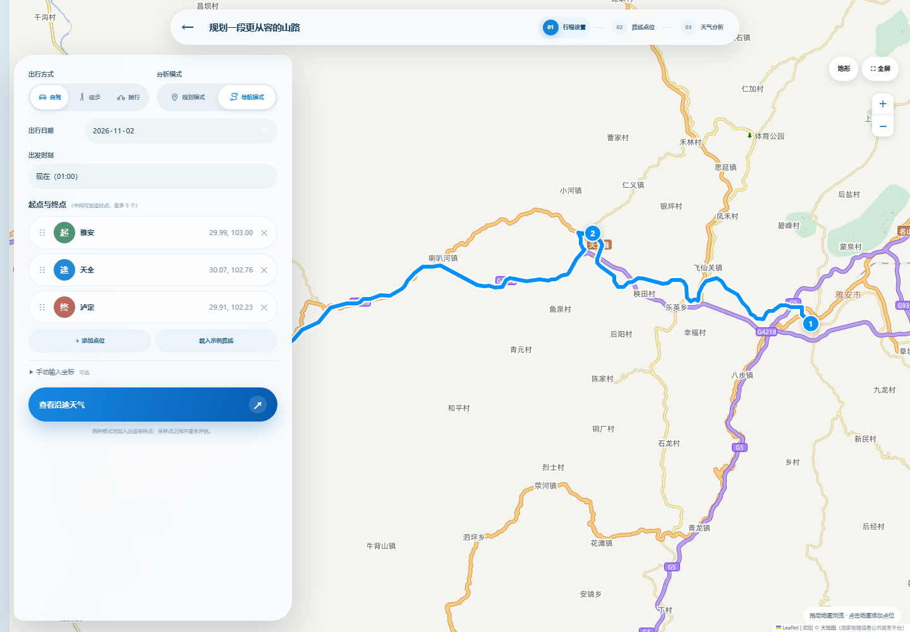
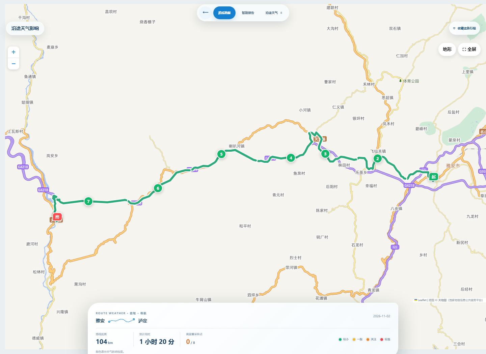

# RouteWeather 2.0 · 山途智行

**看见天气，预见风险，让山路出发更从容。**

RouteWeather 把天气预报、路线、海拔和出发时间放进同一份行程分析，帮助山地出行提前了解沿途天气变化，找到更合适的安排。

[在线体验 · GitHub Pages](https://xzl2007.github.io/route-weather/?demo=1) · [项目源码](https://github.com/xzl2007/route-weather)

打开体验页后，可从探索首页载入示例路线 **雅安 → 天全 → 泸定**。

## 界面预览

<table>
  <tr>
    <td width="50%"><p align="center"><sub>探索首页 · 进入路线天气分析</sub></p></td>
    <td width="50%"><p align="center"><sub>路线规划 · 地图展示所选出行方式的路网</sub></p></td>
  </tr>
  <tr>
    <td colspan="2"><p align="center"><sub>沿途天气 · 按实际路线区段展示天气影响</sub></p></td>
  </tr>
</table>

## 产品体验

- **路线规划**：搜索地名、地图选点或使用示例路线；支持自驾、骑行、徒步，以及规划和导航两种分析模式。
- **路网地图**：普通、地形、影像三种底图；导航模式按实际路线展示天气影响区段，点击路线点位可查看对应天气。
- **沿途天气**：结合路线采样、海拔和预计到达时间，查看点位天气、风雨变化与重点路段。
- **出发时间**：比较不同出发时刻的天气表现，并查看推荐时间和行程建议。
- **行程收藏**：保存、筛选和回看本机记录，也可复制分享链接、摘要或打印报告。

## 两种分析模式

| | 规划模式 | 导航模式 |
|---|---|---|
| 输入 | 关键点位及各点位时间 | 起点、终点和可选途经点 |
| 路径 | 规划页地图按出行方式预览路网；天气估算按点位间直线距离 × 1.25 计算 | 按所选出行方式加载真实路网，并沿路线采样 |
| 时间 | 用户安排每个点位的出发或到达时间 | 根据出发时间和路网时长估算各点到达时刻 |
| 输出 | 点位天气、逐小时变化、行程评分与出发时段对比 | 路线地图、沿途天气、重点路段和出发建议 |

### 导航路网

| 出行方式 | 路网来源 | 用时口径 |
|---|---|---|
| 自驾 | OSRM `driving` | 使用路网返回时长估算 |
| 骑行 | BRouter `fastbike-asia-pacific` | 按 15 km/h 平均速度估算 |
| 徒步 | BRouter `trekking` | 按 4 km/h 平均速度估算 |

### 评分方式

点位天气评分从 100 分开始，结合降水、风速、气温、天气现象和海拔计算。路线综合分由采样点平均分（70%）与最低分（30%）组成，并对低分路段设置上限，避免局部较差天气被平均值掩盖。

| 分数 | 结果 |
|---|---|
| 80–100 | 适宜 |
| 60–79 | 一般 |
| 40–59 | 谨慎 |
| 0–39 | 不建议 |

## 数据与隐私

| 数据 | 来源 |
|---|---|
| 天气与海拔 | [Open-Meteo](https://open-meteo.com/)（CC BY 4.0） |
| 自驾路线 | [OSRM](https://project-osrm.org/) 与 OpenStreetMap |
| 骑行、徒步路线 | [BRouter](https://brouter.de/) 与 OpenStreetMap |
| 地图与地名搜索 | [天地图](https://www.tianditu.gov.cn/)；备用底图来自 OpenStreetMap / Esri |

无需注册。行程记录保存在当前浏览器；查询天气和路线时，应用会向相应服务发送所需的地点坐标。分享链接包含行程点位和时间。

评分和到达时间用于行程安排参考；山地天气、道路与步道状况可能变化，出发前请查看官方信息并结合现场情况判断。

## 本地运行

项目无需构建步骤。在项目根目录启动静态服务器：

```powershell
python -m http.server 8000
```

然后打开 [http://localhost:8000](http://localhost:8000)。地图、天气、地名搜索和路径规划需要联网。

可运行仓库内的验证脚本：

```powershell
node test/nav-test.js
node test/plan-test.js
node test/edge-test.js
```

`node test/algo-test.js` 会请求 Open-Meteo 天气和海拔数据。

## 技术栈

原生 HTML、CSS、JavaScript，Leaflet 地图，浏览器本地存储与 Service Worker；无需构建工具或后端服务。

## 项目文件

| 路径 | 作用 |
|---|---|
| `index.html` | 页面入口与应用结构 |
| `css/` | 首页、规划页、地图和报告的界面样式 |
| `js/app.js` | 页面状态、交互和行程流程 |
| `js/map.js`、`js/route-segments.js` | Leaflet 地图、路线分段与天气点位联动 |
| `js/routing.js`、`js/scoring.js` | 出行路网、天气评分与建议 |
| `js/api.js`、`js/geocode.js`、`js/points.js` | 天气/海拔请求、地点搜索与内置点位 |
| `js/storage.js`、`js/config.js` | 本机行程记录与地图服务配置 |
| `assets/`、`icons/`、`shots/` | 品牌图片、应用图标与界面预览 |
| `test/`、`vendor/leaflet/` | 验证脚本与 Leaflet 静态资源 |
